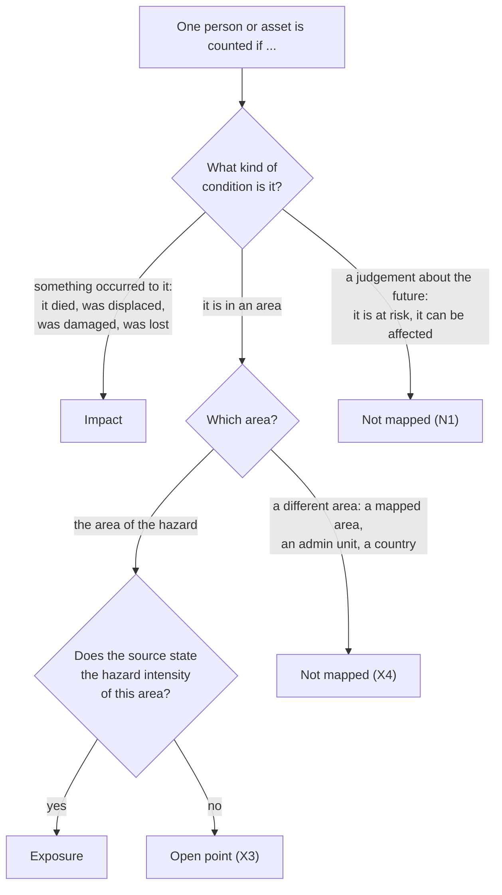

# Exposure ↔ Impact Boundary Rules

> **Status:** Draft. Boundary-rules document for the Exposure class (`monty:exposure_detail`). It specifies how to decide, for each figure of a source, if the figure is an Exposure item, an Impact item, or no item. The field definitions are in the [extension specification](https://github.com/IFRCGo/monty-stac-extension#exposure).

Exposure and impact are two different steps between a hazard and its consequences:

```text
population and assets  →  exposed  →  affected, harmed, lost
   (a place)             (Exposure)        (Impact)
```

- **Exposure** is where a hazard meets people and assets: `Exposure = hazard area ∩ population or assets`.
  UNDRR defines it as "the situation of people, infrastructure, housing, production capacities and other
  tangible human assets located in hazard-prone areas"
  ([UNDRR terminology](https://www.undrr.org/terminology/exposure)). It counts **presence**.
- **Impact** is what the hazard did. UNDRR defines the disaster impact as "the total effect, including
  negative effects (e.g., economic losses) and positive effects (e.g., economic gains), of a hazardous
  event or a disaster"
  ([UNDRR terminology](https://www.undrr.org/terminology/disaster)). It counts **effects**: deaths,
  people affected, buildings destroyed, economic loss.

What separates the two is **vulnerability**. The same exposure gives a small impact where the
buildings are strong, and a large impact where they are weak. Thus an exposure figure is an input of
an impact estimate. It is not a first value of the impact, and it is not an upper limit that the
impact approaches.

One earthquake shows the distance between the two. For the M 7.1 earthquake of 7 January 2025 in the
Southern Tibetan Plateau ([`us6000pi9w`](sources/USGS/README.md#exposure-items-from-pager)), USGS PAGER gives:

| Figure | Value | Class |
| ------ | ----- | ----- |
| People who felt light shaking (MMI IV) | 130 864 619 | Exposure |
| People who felt strong shaking or more (MMI VI to IX) | 99 126 | Exposure |
| Fatalities, as the PAGER loss model estimates them | 858 | Impact, modelled |

The 130.9 million people were in the shaking area. They were not harmed. A user who reads the first
figure as "people affected" is wrong by five orders of magnitude.

Why Monty needs a rule: sources publish the two kinds of figure in the same way, as a number with a
label such as "population" or "affected". When a catalogue stores the two as one class, a sum of the
"affected" figures of an event mixes presence and effects, and it has no meaning. Monty thus keeps
them in two classes, with two roles and two collections.

This document is source-agnostic. The mapping of each source is in its
[source document](sources/README.md).

---

## 1. Decision procedure

The class of a figure does not depend on its label in the source ("affected", "population",
"exposed"). It depends on the **counting rule**: the condition that one person or one asset must
satisfy to be in the figure.

**Step 1. Write the counting rule of the figure as one sentence:**

> One person (or one asset) is counted if ...

Use the method document of the source, not the name of the field. If the source does not give the
counting rule, the figure is not mapped.

**Step 2. Read the sentence, and follow the tree:**



The first question is the important one. It has three answers, and they do not overlap:

| The condition is about | Example of a counting rule | Class |
| ---------------------- | -------------------------- | ----- |
| **An effect** on the person or the asset | "... if the person died" | Impact |
| **A location** of the person or the asset | "... if the person lives where the wind is 39 kt or more" | Exposure, if the area is the hazard area and the intensity is stated |
| **A judgement** about what can occur | "... if the person is at high risk" | Not mapped |

A model does not change the answer. A loss model that estimates deaths gives an Impact with
`estimate_type: modelled`: its counting rule is "the model estimates that the person died". A model
that puts a population dataset on a wind field gives an Exposure: its counting rule is a location.

**Step 3. Check the result with real figures:**

| Figure | Counting rule: one person is counted if ... | Result |
| ------ | ------------------------------------------- | ------ |
| GDACS `pop39` | ... the person lives in the wind field of 39 kt or more | Exposure |
| USGS PAGER, population at MMI VI | ... the person lives where the shaking intensity is MMI VI | Exposure |
| USGS PAGER, estimated fatalities | ... the loss model estimates that the person died | Impact, modelled |
| Deaths in a situation report | ... an authority reports that the person died | Impact |
| GDACS `popstormsurge` | ... the person lives in the storm surge zone (no intensity stated) | Open point (X3) |
| Population of the area of interest of a satellite map | ... the person lives in the mapped area | Not mapped (X4) |
| People at highest risk in a field report | ... the report judges that the person is at risk | Not mapped (N1) |

## 2. Pattern catalogue

| # | Pattern | Example | Class | Note |
| - | ------- | ------- | ----- | ---- |
| X1 | Population or assets inside a hazard area, with a stated intensity threshold | People in the wind field of 39 kt or more of a cyclone | Exposure | `intensity_range: at_or_above` |
| X2 | Population or assets per intensity level | People per level of shaking intensity (MMI) of an earthquake | Exposure | `intensity_range: band`. One item per level |
| X3 | Population or assets inside a hazard area, with no stated intensity | People in a storm surge zone; people in a burnt area | Open point (§5) | The class requires an intensity |
| X4 | Total population or assets of a mapped area | The population of an area of interest of a satellite map | Not Exposure, not Impact | The area is the area of the map, not the area of the hazard |
| I1 | Reported effect | Deaths that an authority reports | Impact | |
| I2 | Modelled effect | Fatalities or economic losses that a loss model estimates | Impact | `estimate_type: modelled`. A loss model already applies vulnerability to the exposure. Its result is not an exposure |
| I3 | Observed damage | Buildings destroyed in a damage grading map | Impact | See also the [Response ↔ Impact boundary rules](response-impact-boundary.md) |
| N1 | Risk or alert indicator: people at risk before or outside a hazard area, an alert score | People at highest risk in a field report; the alert score of a track point | Not Exposure, not Impact | It is not an effect, and it is not a count inside a hazard area for a stated intensity. Monty has no class for it, and it is not mapped |
| N2 | People or assets with no effect | The unaffected buildings of a damage grading map | Not Impact | An impact figure counts an effect. A figure of no effect is not mapped |
| R1 | Reach of a response | People assisted by an operation | Not Exposure | It measures the response. See the [Response ↔ Impact boundary rules](response-impact-boundary.md) |

## 3. Rules for an Exposure item

1. **The hazard link is mandatory.** An Exposure item has a `related` link with
   `roles: ["hazard"]` to the Hazard item that it refers to. The JSON Schema enforces this rule.
2. **The intensity is mandatory.** `intensity_value`, `intensity_unit` and `intensity_range` say
   which intensity of the hazard the figure counts. A count without an intensity cannot be compared
   with a different count.
3. **One item for each intensity.** A source that gives a figure for two thresholds, or for six
   intensity levels, produces one Exposure item for each.
4. **Do not add figures that overlap.** Figures with `intensity_range: at_or_above` for two
   thresholds of one hazard overlap: the people at 74 kt or more are also at 39 kt or more.
   Figures with `intensity_range: band` do not overlap, and a client can add them.
5. **The geometry is the area that the figure covers.** If the source does not give this area, and
   the transformer cannot compute it from the Hazard item, the geometry is `null`. The geometry is
   never a point copied from the hazard: a point is a location, not an area. The geometry is never
   an area larger than the area that the figure covers.
6. **`estimate_type` says where the figure comes from.** An exposure figure is usually
   `modelled`: a model puts a population dataset on the hazard area.
7. **Never add an Exposure figure to an Impact figure.** The two are in different collections
   (`<source>-exposure` and `<source>-impacts`) and in different objects
   (`monty:exposure_detail` and `monty:impact_detail`), so that a query does not mix them by
   accident.

## 4. When the footprint is not available

An Exposure item always refers to a Hazard item. But the Hazard item does not always give the area
of the hazard:

- The Hazard item can be a point, which gives a location and no extent.
- The source can publish an exposure figure and not publish the area that it used.

In these cases:

- The Exposure item keeps the hazard link, the intensity and the method information that the
  source gives.
- Its `geometry` is `null`.
- A client cannot check the figure or compute it again. A client finds the item through the hazard
  link, `monty:country_codes` or `monty:corr_id`. A spatial search does not return it.

## 5. Open point

- **Hazards with an extent and no intensity scale (pattern X3).** For a flood extent, a burnt area
  or a storm surge zone, the source gives a count inside the area and no intensity value. The
  class requires an intensity. Until this point is decided, such a figure has no mapping.

## See also

- [Extension specification: Exposure](https://github.com/IFRCGo/monty-stac-extension#exposure)
- [Response ↔ Impact boundary rules](response-impact-boundary.md)
- [Taxonomy: exposure category](taxonomy.md#exposure-category)
- [Discussion #110](https://github.com/IFRCGo/monty-stac-extension/discussions/110): two gaps in the impact model
